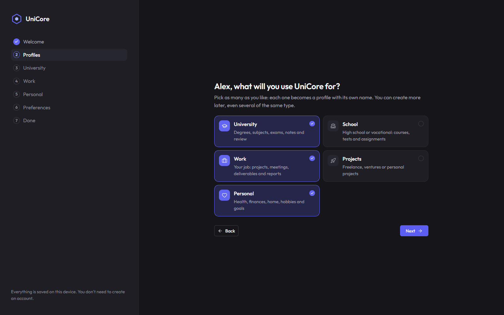
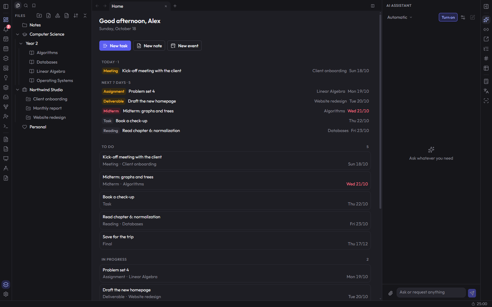
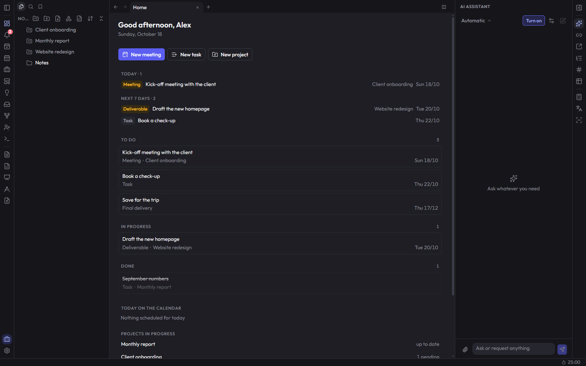
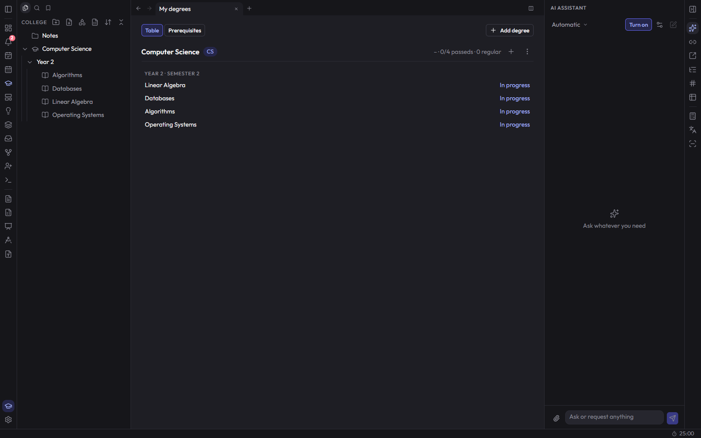
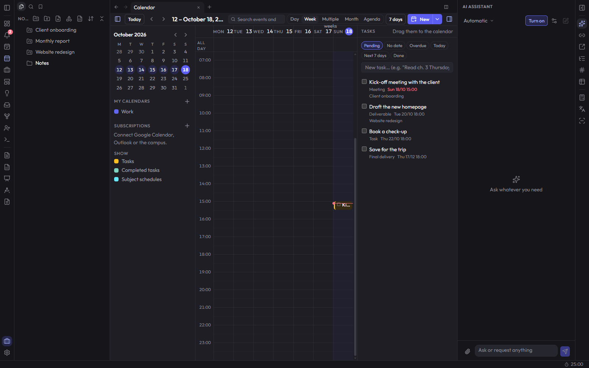

# UniCore

**One desktop app for your studies, your job, your side projects and your personal life — and everything stays on your computer.**

> **Windows desktop app only.** There is no web or browser version. [Download the latest installer](https://github.com/baninafra/unicore/releases/latest); installed apps update themselves with one click.

UniCore started as a way to organize university life (degrees, courses, exams, notes) and grew into a general workspace: you can have a profile for college, another for your job, one for freelance projects and one for your personal life, and the app adapts its vocabulary, sections and home screen to each of them. It combines Obsidian-style notes, a task board, a full calendar, spaced-repetition flashcards, built-in office editors and an AI assistant that runs on your own machine.



## 100% local, no accounts

- **No sign-up, no login, no cloud.** You install it and start using it.
- **Your data lives on your disk**, in `Documents\UniCore` (a SQLite database plus a folder with your files). You can back it up, sync it with your own tools or delete it at any time.
- **No telemetry, no analytics, no tracking.** UniCore never sends your notes, tasks or files anywhere, and it has no server of its own.
- **The AI runs locally.** The assistant uses an open model (Qwen) through `llama.cpp` on your own computer. Your questions and documents are not sent to anyone.

UniCore only goes online when **you** use a feature that needs it:

| When | What it connects to |
| --- | --- |
| First time you enable the AI or the translator | Downloads the open model files (Hugging Face, llama.cpp releases). After that it works offline. |
| You ask the AI to search the web | DuckDuckGo / Wikipedia, only for that search. |
| You subscribe to an external calendar | The iCal link you pasted (Google Calendar, Outlook, your campus…). |
| You share a note with someone | A direct, password-protected peer-to-peer connection (WebRTC); public relays are used only so both computers can find each other. |
| You embed a YouTube or Vimeo video in a note | That video's player. |
| You choose the optional cloud AI (Groq) | Groq's API, with your own key. Off by default. |

## Features

- **Profiles**: University, School, Work, Projects and Personal. Create as many as you like, even several of the same type (two jobs, for example). Each profile changes the names (degrees and courses, projects, areas), the task types (exam, assignment / meeting, deliverable / goal…), the sections and what the Home screen shows.
- **Guided setup**: the first time, a short wizard asks about your degree and courses, your job and working hours (they go straight into the calendar), your projects and your preferences, and builds everything for you.
- **Notes like Obsidian**: Markdown blocks, `[[links]]`, backlinks, tags, daily notes, templates, canvases, a graph view and version history.
- **Tasks and calendar**: kanban board, agenda, local calendars with recurring events and reminders, iCal subscriptions, and a semester schedule for each course.
- **Study tools**: spaced-repetition flashcards (FSRS), AI-generated quizzes, grade averages, a scientific calculator, a function plotter, unit and number-base converters, and a translator.
- **Reading material**: import PDFs (scanned pages are read with Windows' built-in OCR), highlight them, and turn them into notes; the AI can summarize them.
- **Document scanner**: take photos of pages, fix the perspective and save them as PDF or text.
- **Custom folders** with any name and the icon you choose.
- **Six languages**: Spanish, English, French, German, Portuguese and Chinese.

| Home | Work profile |
| --- | --- |
|  |  |
| **Degrees** | **Calendar** |
|  |  |

## Built-in apps

UniCore embeds full editors so you don't need to leave the app (or install Office) to work with files:

- **Documents** (`.docx`), **spreadsheets** (`.xlsx`) and **presentations** (`.pptx`), opened and saved in the standard formats.
- **PDF editor**: open, annotate, rotate and reorder pages, and save PDFs.
- **Geometry and graphing**: interactive constructions and function plots for math classes.

The office and PDF editors are Rust applications compiled to WebAssembly that run inside UniCore, completely offline. They talk to the app through a small message bridge, so the AI assistant can also read and edit those files for you. They are built from open-source projects (MIT / Apache-2.0) with a patch that integrates them into UniCore; see `scripts/build-editors.sh`. The geometry tool uses GeoGebra's offline math-apps bundle (free for non-commercial use), downloaded by `scripts/fetch-vendor.sh`. None of these editors are stored in this repository; the scripts download and build them.

## AI assistant

The assistant can create and edit tasks, courses, notes, flashcards and files, load a course schedule from a pasted syllabus, summarize your reading material, quiz you, search inside your notes and, if you ask, search the web. It knows your profiles and answers in the language you picked. By default it runs on your own computer; nothing you write to it leaves your machine.

## Running it

UniCore is a desktop app only. Requirements: Node.js 20+ and Rust with [Tauri 2](https://tauri.app/start/prerequisites/).

```bash
npm install
npx tauri dev          # run the desktop app in development
npx tauri build        # Windows installer (src-tauri/target/release/bundle)
```

The embedded editors are fetched and built separately: `bash scripts/build-editors.sh` (needs Rust with the `wasm32-unknown-unknown` target and `trunk`) and `bash scripts/fetch-vendor.sh`.

## Tech stack

Next.js 15 (static export) + React 19 + TypeScript + Tailwind CSS 4, wrapped in Tauri 2 for the desktop app. Data lives in SQLite on disk (with a full-text index for search), with Dexie (IndexedDB) as the interface cache. BlockNote for notes, React Flow for canvases, ts-fsrs for flashcards, pdf.js for PDFs, Windows.Media.Ocr for OCR (Tesseract as a fallback), llama.cpp for the AI.

## Translations

UI strings are written in Spanish inside `t("…")` (`src/lib/i18n.ts`); the Spanish text is the key, and each language has its own file in `src/locales/`. To see what is missing:

```bash
node scripts/i18n-extract.mjs
```

## Project layout

- `src/views/`: screens (Home, note, course or project, calendar, settings…).
- `src/components/`: UI pieces.
- `src/lib/`: local database, profiles, AI, calendar and languages.
- `src-tauri/`: the desktop app in Rust (data folder, search index, OCR, local AI server).
- `editors/patches/`: the integration patches for the embedded editors.
- `docs/convenciones.md`: coding conventions (in Spanish).

## License

[PolyForm Noncommercial 1.0.0](LICENSE): you can use, copy, modify and share UniCore for any **non-commercial** purpose — personal use, studying, research, schools and non-profit organizations. Commercial use (selling it, or using it to provide a paid product or service) is not allowed without permission.

The embedded office and PDF editors are based on projects licensed under MIT / Apache-2.0, and the geometry tool on GeoGebra's math apps (non-commercial license); their licenses are copied when they are downloaded or built.
